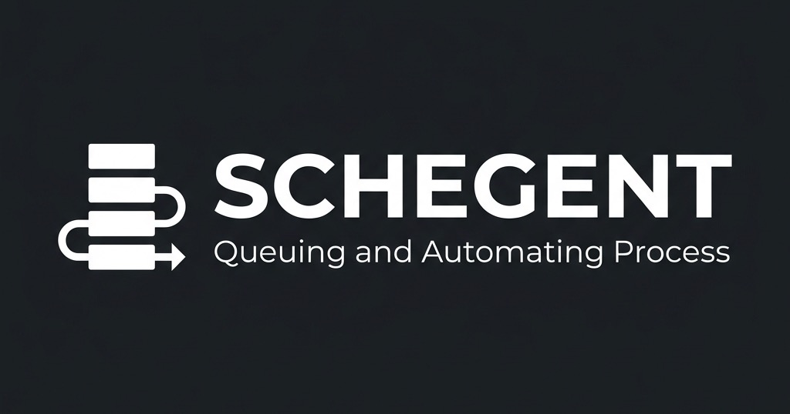

# Schegent

Schegent is a local-first VS Code extension that queues development Tasks, executes versioned Workflows of AI-backed Phases, and projects Run evidence into a sidebar and dashboard. It orchestrates installed Claude, Codex, or Agy CLIs inside the operator's workspace; it does not provide a hosted backend, ship ready-made process definitions, or promise offline AI execution. There are two definition kinds: a Phase is one AI-backed step, and a Workflow is a graph whose nodes each target a Phase or a child Workflow.

<!-- Source: package.json -->
<!-- Source: src/extension.ts -->
<!-- Source: src/runner/backend-runner-factory.ts -->
<!-- Source: src/config/pipeline-config.ts -->

## Technology

- VS Code extension host, TypeScript, and one esbuild CommonJS bundle at `dist/extension.js`.
- Svelte 5 webviews built with Vite 7 for the sidebar and dashboard.
- Source builds require Node.js 22.22.3 or newer in 22.x, or 24.15.0 or newer in 24.x. The VSIX requires **VS Code 1.125 or newer**.
  That floor is **qualified, not merely declared** (FR-R3-059): `@types/vscode` is pinned to it
  exactly with no range operator, the host compiles against that API surface, and the live
  extension-host integration leg **downloads and runs the declared floor binary** rather than
  whatever is current — the version is derived from `engines.vscode`, so the claim and the evidence
  cannot drift apart. Gates fail if the types resolve above the floor, if the pin gains a range
  operator, or if the harness stops deriving its version from the manifest.
- English only, by decision: command titles, settings, dialogs and webview text are not localized. The decision, what it measured and what would reopen it are in [English-only is a product decision](docs/concepts/english-only-not-localizable.md).
- Vitest for host and webview tests, Playwright for visual tests, and the VS Code Electron harness for integration tests.
- Structured state (Runs, the Queue, catalog definitions, the usage ledger, handoffs, lanes and reports) lives, after a one-time cutover in a trusted primary window, in an embedded SQLite store: Node's built-in `node:sqlite`, no ORM. The canonical database is folder-keyed in extension global storage, outside the workspace (`<globalStorageUri>/sqlite/<scope>/schegent-state.db` with `-wal` and `-shm` sidecars, schema 9 / `min_reader_version = 9`; legacy per-window `storageUri` is retained only as a one-time relocation source or unwritable-target fallback); see [SQLite application store](docs/operations/sqlite-application-store.md) and [the rollback runbook](docs/operations/sqlite-rollback-runbook.md). The audit log, transcripts and other evidence files stay in workspace-local `.schegent/` files, and VS Code `workspaceState` holds the pre-cutover copies and UI preferences. There is no Schegent HTTP server or Schegent-owned CLI executable.

<!-- Source: package.json -->
<!-- Source: webview-ui/package.json -->
<!-- Source: esbuild.config.mjs -->
<!-- Source: src/state/workspace-state.ts -->
<!-- Source: src/services/sqlite-store/storage-location-resolver.ts -->

## Get started

Schegent is currently **private-to-author engineering preview** with no published GitHub Release or Marketplace listing; package a local VSIX from source (`npm run release` for a candidate record, or `npm run package` for local trial only; see [Releasing](RELEASE.md)). Open a folder you can restore and ensure at least one supported backend executable is authenticated and available on `PATH` or configured by path. The default backend (Claude) is uncontained, so a fresh install **refuses its first run** until you name it in `schegent.backend.uncontainedBackends` or select a backend that carries its own sandbox — see [Backend permission posture](#backend-permission-posture) below. You are not left to find that setting on your own: the refusal asks, in a dialog that names the backend and what granting it means, and writes that one id to your User settings if you approve. Cancelling declines and starts nothing, and approving is asked once per machine. Schegent ships an empty catalog, so import (for example from `examples/speckit-new-feature.workflow.yaml`) or author and publish at least one Phase and Workflow. Then launch from a Queue: **Add work**, choose the Workflow under **Workflows**, and **Trigger**; [Launching work](docs/explanation/core-concepts.md#launching-work) walks through it. A few older Pipeline surfaces remain on a current install, the `schegent.defaultPipelineId` setting among them; none is the way to launch, and [Current limitations](docs/explanation/core-concepts.md#current-limitations) lists them. Before a first run, read what leaves the machine whatever the capture settings say: [egress and the raw transcript's lifetime](docs/concepts/local-first-not-offline.md#egress-and-the-raw-transcripts-lifetime).

<!-- Source: package.json -->
<!-- Source: RELEASE.md -->
<!-- Source: src/config/pipeline-config.ts -->
<!-- Source: src/services/backend-capability-service.ts -->

Choose one outcome instead of reading the documentation directory in order:

| Goal | Start here | Stop when |
|---|---|---|
| Use Schegent without learning its internals | [Course: Use Schegent](docs/courses/use-schegent.md) | A Task is queued and its Run evidence is visible. |
| Understand and change Schegent | [Course: Develop Schegent](docs/courses/develop-schegent.md) | A scoped change passes its relevant checks and is ready for review. |

The [documentation path selector](docs/README.md) routes maintainers, release engineers, and security reviewers to their specialist references.

<!-- Source: docs/README.md -->
<!-- Source: docs/courses/use-schegent.md -->
<!-- Source: docs/courses/develop-schegent.md -->

## Support matrix

Distinguish three separate claims: **source buildability** (whether TypeScript and the Svelte webview compile from source), the **Linux arm64 unit leg** (`npm run verify:linux`, which runs headless host/contract tests inside a Linux container without VS Code or live provider CLIs), and **qualified editor/backend tuples** (an observed local VS Code extension host running real ACP backend transport). Only local **macOS arm64** has observed editor-host and backend qualification evidence; Linux desktop editors, Windows editors, and Remote hosts ship **unqualified** (and remote hosts refuse ACP launch before spawn). That is a statement about evidence, not about quality. The declared support surface is
[the platform observation record](docs/operations/platform-observation-record.md#the-declared-support-surface),
and this table defers to it.

| Platform | Status | The observation that is still owed |
|---|---|---|
| Local macOS, arm64 | **observed (editor/backend tuple)**: archived clean-tree `npm run gate` exited 0 under Node `v24.19.0` / VS Code `1.125.0` at `9c395bcd` on 2026-11-27 (merged at `60f5abc0`); all three installed providers passed live shipped-transport connectivity turns on 2026-11-27 (`claude` `2.1.332`, `codex` `0.171.0-alpha.13.2`, `agy` `1.5.18` at `8306c78f` / `2026-11-27T05:46:51.135Z` in the [backend qualification log](docs/release/backend-qualification-log.md#2026-11-27--macos-270-arm64-node-24222)). Live connectivity is distinct from OS containment qualification, maintained separately in [Backend containment qualification](docs/architecture/backend-containment-qualification.md). | Node 22 full editor leg on macOS in the [qualification matrix](docs/release/qualification-matrix.md); the human VoiceOver recovery journey in the [assistive-technology matrix](docs/release/accessibility-at-matrix.md); independent Criterion 8 review and recipient-verifiable provenance for any external pilot in [preview RC evidence](docs/release/preview-rc-evidence.md) |
| Linux (desktop editor & backends) | **unqualified** (source builds and container Linux arm64 unit leg `npm run verify:linux` observed separately; neither qualifies a Linux VS Code editor or backend CLI) | Live Linux VS Code extension-host & ACP backend rows in the [qualification matrix](docs/release/qualification-matrix.md); the Orca row in the [assistive-technology matrix](docs/release/accessibility-at-matrix.md) |
| Windows | **unqualified** | The Windows rows in the [qualification matrix](docs/release/qualification-matrix.md); the NVDA and Narrator rows in the [assistive-technology matrix](docs/release/accessibility-at-matrix.md). The Windows safety paths in the source still apply. |
| Remote hosts (Remote SSH, Dev Container, WSL) | **unqualified (refused before ACP spawn)** | [Remote development is unqualified](docs/operations/backends.md#remote-development-is-unqualified), and the remote extension-host row in [Backend containment qualification](docs/architecture/backend-containment-qualification.md) |

<!-- Source: docs/operations/platform-observation-record.md -->
<!-- Source: docs/release/qualification-matrix.md -->
<!-- Source: docs/release/accessibility-at-matrix.md -->
<!-- Source: docs/release/backend-qualification-log.md -->
<!-- Source: docs/architecture/backend-containment-qualification.md -->

## Backend permission posture

Claude is the default backend. Claude and Agy run with CLI approval prompts off and act without asking through `--dangerously-skip-permissions`; Schegent supplies neither with an OS-enforced filesystem bound, and both are therefore **refused by default** — `schegent.backend.uncontainedBackends` (application-scoped, default `[]`) is the explicit opt-in that unlocks them, **one backend at a time**: allowing `agy` does not allow `claude`. The refusal offers that opt-in where it happens, as a dialog answered before anything is spawned; approving writes the refused id and no other, dismissing denies, and the setting stays the one place the grant lives and is withdrawn. What OS-enforced containment each backend actually has is qualified per `(backend, OS, architecture, CLI version)` tuple in [Backend containment qualification](docs/architecture/backend-containment-qualification.md) — separate from live transport connectivity in [Backend qualification log](docs/release/backend-qualification-log.md) — and when naming a backend is and is not acceptable is owned by [Running Schegent on a repository you do not trust](docs/operations/untrusted-repositories.md). Codex is the exception: it runs non-interactively with the `--sandbox workspace-write` sandbox, which permits workspace writes while leaving `.git` read-only, and Schegent admits it without an uncontained grant only when the installed Codex executable matches a containment-qualified tuple (unqualified Codex builds or platforms are refused by default until explicitly granted in `schegent.backend.uncontainedBackends`). Point Schegent only at a checkout you can recover, and review [Backend operations](docs/operations/backends.md) plus the [operator threat model](docs/security/threat-model.md) before unattended execution.

<!-- Source: package.json -->
<!-- Source: src/runner/claude-cli.ts -->
<!-- Source: src/runner/codex-cli.ts -->
<!-- Source: src/runner/agy-cli.ts -->

## Development

New contributors should begin with [Course: Develop Schegent](docs/courses/develop-schegent.md).

```bash
nvm use
npm ci
npm --prefix webview-ui ci
```

**Two commands, and the second one is the point.** `.npmrc` sets `ignore-scripts=true` in both
trees (`FR-R3-090`), so the root `postinstall` that used to install `webview-ui` does not run.
Without the second command, `npm run build` stops immediately at `scripts/check-webview-install.mjs`
with a fail-fast diagnostic instructing you to run `npm --prefix webview-ui ci`. `CONTRIBUTING.md` is the authority for this sequence (rehearsed in [Contributor setup rehearsal](docs/development/contributor-setup-rehearsal.md)). A page that repeats it is
registered with `tests/lint/procedure-surface-registry.test.ts`, which fails a copy that drops the
second command.

Then verify:

```bash
npm run gate
npm run build
```

`npm run gate` is the full verification. It runs the five repository checks (`contracts:check`, `docs:check`, `security:secrets`, `security:actions` and `license:check`), then `npm run ci`. `npm run ci` runs the typechecks, lint, the builds, coverage, and the eval, visual, accessibility, performance and E2E suites, then package smoke and the extension-host integration tests, but none of the five checks. `npm run verify:all` is the lighter local check: it builds the webview, runs the five checks, the typechecks, lint, the host tests and webview coverage, and none of the browser-backed, packaging or integration suites.

<!-- Source: package.json -->

Schegent is licensed under MIT.

<!-- Source: LICENSE.md -->
<!-- Source: package.json -->
