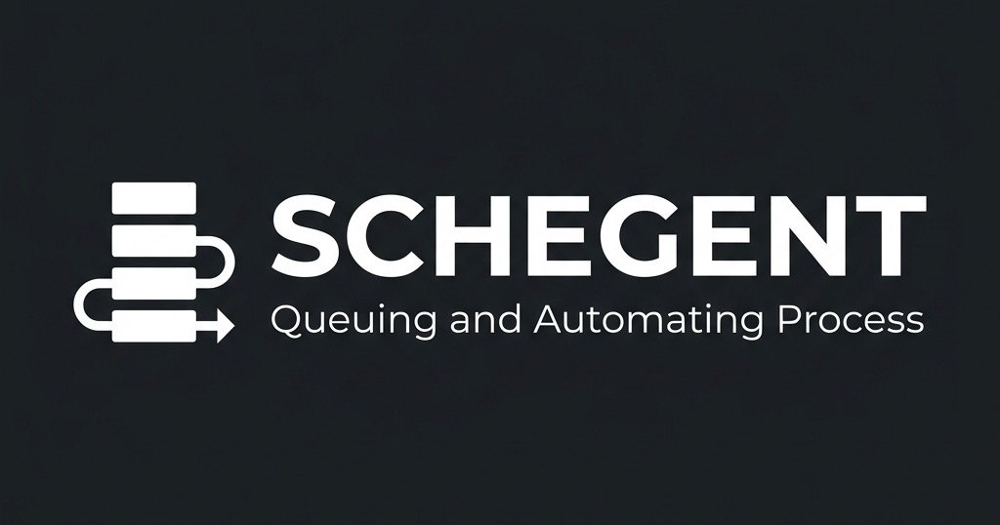

# Schegent

Schegent is a local-first VS Code extension that queues development Tasks, executes versioned Workflows of AI-backed Phases, and projects Run evidence into a sidebar and dashboard. It orchestrates installed Claude, Codex, or Agy CLIs inside the operator's workspace; it does not provide a hosted backend, ship ready-made process definitions, or promise offline AI execution. There are two definition kinds: a Phase is one AI-backed step, and a Workflow is a graph whose nodes each target a Phase or a child Workflow.

<!-- Source: package.json -->
<!-- Source: src/extension.ts -->
<!-- Source: src/runner/backend-runner-factory.ts -->
<!-- Source: src/config/pipeline-config.ts -->

## Technology

- VS Code extension host, TypeScript, and one esbuild CommonJS bundle at `dist/extension.js`.
- Svelte 5 webviews built with Vite 7 for the sidebar and dashboard.
- Source builds use Node.js 22 or 24; installed VSIX builds require **VS Code 1.107 or newer**.
  That floor is **qualified, not merely declared** (FR-R3-059): `@types/vscode` is pinned to it
  exactly with no range operator, the host compiles against that API surface, and the live
  extension-host integration leg **downloads and runs the declared floor binary** rather than
  whatever is current — the version is derived from `engines.vscode`, so the claim and the evidence
  cannot drift apart. Gates fail if the types resolve above the floor, if the pin gains a range
  operator, or if the harness stops deriving its version from the manifest.
- English only, by decision: command titles, settings, dialogs and webview text are not localized. The decision, what it measured and what would reopen it are in [English-only is a product decision](docs/concepts/english-only-not-localizable.md).
- Vitest for host and webview tests, Playwright for visual tests, and the VS Code Electron harness for integration tests.
- Structured state (Runs, the Queue, catalog definitions, the usage ledger, handoffs, lanes and reports) lives, after a one-time cutover in a trusted primary window, in an embedded SQLite store: Node's built-in `node:sqlite`, no ORM. The database is in the extension's host storage, outside the workspace (`<storage>/sqlite/<scope>/schegent-state.db` with `-wal` and `-shm` sidecars); see [SQLite application store](docs/operations/sqlite-application-store.md). The audit log, transcripts and other evidence files stay in workspace-local `.schegent/` files, and VS Code `workspaceState` holds the pre-cutover copies and UI preferences. There is no Schegent HTTP server or Schegent-owned CLI executable.

<!-- Source: package.json -->
<!-- Source: webview-ui/package.json -->
<!-- Source: esbuild.config.mjs -->
<!-- Source: src/state/workspace-state.ts -->
<!-- Source: src/services/sqlite-store/storage-location-resolver.ts -->

## Get started

Install a tagged-release VSIX when one is available, or package a VSIX from source. Open a folder you can restore and ensure at least one supported backend executable is authenticated and available on `PATH` or configured by path. The default backend (Claude) is uncontained, so a fresh install **refuses its first run** until you name it in `schegent.backend.uncontainedBackends` or select a backend that carries its own sandbox — see [Backend permission posture](#backend-permission-posture) below. You are not left to find that setting on your own: the refusal asks, in a dialog that names the backend and what granting it means, and writes that one id to your User settings if you approve. Cancelling declines and starts nothing, and approving is asked once per machine. Schegent ships an empty catalog, so import (for example from `examples/speckit-new-feature.workflow.yaml`) or author and publish at least one Phase and Workflow. Then launch from a Queue: **Add work**, choose the Workflow under **Workflows**, and **Trigger**; [Launching work](docs/explanation/core-concepts.md#launching-work) walks through it. A few older Pipeline surfaces remain on a current install, the `schegent.defaultPipelineId` setting among them; none is the way to launch, and [Current limitations](docs/explanation/core-concepts.md#current-limitations) lists them. Before a first run, read what leaves the machine whatever the capture settings say: [egress and the raw transcript's lifetime](docs/concepts/local-first-not-offline.md#egress-and-the-raw-transcripts-lifetime).

<!-- Source: package.json -->
<!-- Source: RELEASE.md -->
<!-- Source: src/config/pipeline-config.ts -->
<!-- Source: src/services/backend-capability-service.ts -->

Choose one outcome instead of reading the documentation directory in order:

| Goal | Start here | Stop when |
|---|---|---|
| Use Schegent without learning its internals | [Course: Use Schegent](docs/courses/use-schegent.md) | A Task is queued and its Run evidence is visible. |
| Understand and change Schegent | [Course: Develop Schegent](docs/courses/develop-schegent.md) | A scoped change passes its relevant checks and is ready for review. |

The [documentation path selector](docs/README.md) routes maintainers, release engineers, and security reviewers to their specialist references.

<!-- Source: docs/README.md -->
<!-- Source: docs/courses/use-schegent.md -->
<!-- Source: docs/courses/develop-schegent.md -->

## Support matrix

One platform has been observed. The others ship but are **unqualified**: nobody has run them for this
project. That is a statement about evidence, not about quality. The declared support surface is
[the platform observation record](docs/operations/platform-observation-record.md#the-declared-support-surface),
and this table defers to it.

| Platform | Status | The observation that is still owed |
|---|---|---|
| macOS, arm64 | **observed**: `npm run gate` exited 0 under Node v24.19.0 at `5a8af6b0` on 2026-11-01 | Node 22 on macOS, in the [qualification matrix](docs/release/qualification-matrix.md); the VoiceOver row in the [assistive-technology matrix](docs/release/accessibility-at-matrix.md) |
| Linux | **unqualified** | The Linux rows in the [qualification matrix](docs/release/qualification-matrix.md); the Orca row in the [assistive-technology matrix](docs/release/accessibility-at-matrix.md) |
| Windows | **unqualified** | The Windows rows in the [qualification matrix](docs/release/qualification-matrix.md); the NVDA and Narrator rows in the [assistive-technology matrix](docs/release/accessibility-at-matrix.md). The Windows safety paths in the source still apply. |
| Remote hosts (Remote SSH, Dev Container) | **unqualified** | [Remote development is unqualified](docs/operations/backends.md#remote-development-is-unqualified), and the remote extension-host row in [Backend containment qualification](docs/architecture/backend-containment-qualification.md) |

<!-- Source: docs/operations/platform-observation-record.md -->
<!-- Source: docs/release/qualification-matrix.md -->
<!-- Source: docs/release/accessibility-at-matrix.md -->

## Backend permission posture

Claude is the default backend. Claude and Agy run with CLI approval prompts off and act without asking through `--dangerously-skip-permissions`; Schegent supplies neither with an OS-enforced filesystem bound, and both are therefore **refused by default** — `schegent.backend.uncontainedBackends` (application-scoped, default `[]`) is the explicit opt-in that unlocks them, **one backend at a time**: allowing `agy` does not allow `claude`. The refusal offers that opt-in where it happens, as a dialog answered before anything is spawned; approving writes the refused id and no other, dismissing denies, and the setting stays the one place the grant lives and is withdrawn. What OS-enforced containment each backend actually has is qualified in [Backend containment qualification](docs/architecture/backend-containment-qualification.md), and when naming a backend is and is not acceptable is owned by [Running Schegent on a repository you do not trust](docs/operations/untrusted-repositories.md). Codex is the exception: it runs non-interactively with the `--sandbox workspace-write` sandbox, which permits workspace writes while leaving `.git` read-only. Point Schegent only at a checkout you can recover, and review [Backend operations](docs/operations/backends.md) plus the [operator threat model](docs/security/threat-model.md) before unattended execution.

<!-- Source: package.json -->
<!-- Source: src/runner/claude-cli.ts -->
<!-- Source: src/runner/codex-cli.ts -->
<!-- Source: src/runner/agy-cli.ts -->

## Development

New contributors should begin with [Course: Develop Schegent](docs/courses/develop-schegent.md).

```bash
nvm use
npm ci
npm --prefix webview-ui ci
```

**Two commands, and the second one is the point.** `.npmrc` sets `ignore-scripts=true` in both
trees (`FR-R3-090`), so the root `postinstall` that used to install `webview-ui` does not run.
Without the second command the first build fails, and it fails somewhere that does not mention
installing. `CONTRIBUTING.md` is the authority for this sequence. A page that repeats it is
registered with `tests/lint/procedure-surface-registry.test.ts`, which fails a copy that drops the
second command.

Then verify:

```bash
npm run gate
npm run build
```

`npm run gate` is the full verification. It runs the five repository checks (`contracts:check`, `docs:check`, `security:secrets`, `security:actions` and `license:check`), then `npm run ci`. `npm run ci` runs the typechecks, lint, the builds, coverage, and the eval, visual, accessibility, performance and E2E suites, then package smoke and the extension-host integration tests, but none of the five checks. `npm run verify:all` is the lighter local check: it builds the webview, runs the five checks, the typechecks, lint, the host tests and webview coverage, and none of the browser-backed, packaging or integration suites.

<!-- Source: package.json -->

Schegent is licensed under MIT.

<!-- Source: LICENSE.md -->
<!-- Source: package.json -->
